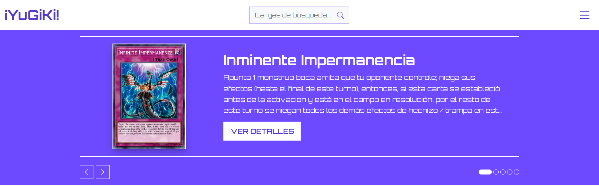
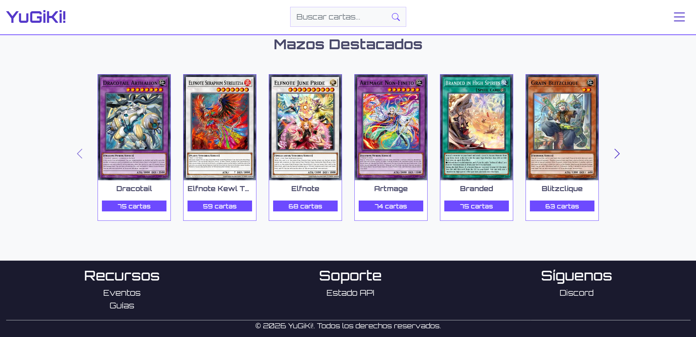
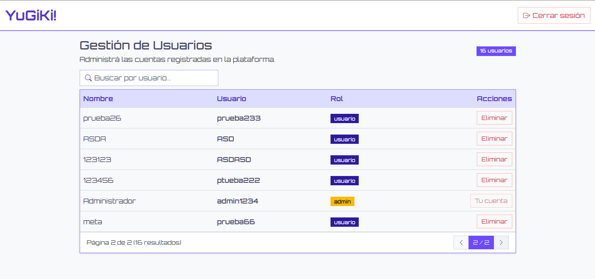

# Guía de uso
**YuGiKi!** • `http://localhost:3000` *(o URL de despliegue)* • v1.0.0

## ¿Para quién es?
Esta guía está dirigida a **cualquier visitante, jugador o entusiasta de Yu-Gi-Oh!** que quiera explorar la wiki de cartas y consultar mazos competitivos populares sin necesidad de registrarse, así como a **usuarios registrados** que deseen crear, editar y guardar sus propios mazos. También incluye las acciones disponibles para **administradores** encargados de gestionar las cuentas de la pagina.

---

## Primeros pasos

### Explorar como visitante (sin registro)
No necesitás crear una cuenta para navegar por **YuGiKi!**. Apenas ingresás a la aplicación desde tu navegador, podés:
* Consultar el catálogo completo de cartas, filtrar por nombre o raza/tipo (`race`), ver el top 10 de cartas populares y ver en detalle cada una. 
* Explorar los mazos competitivos populares y revisar su composición completa (Main Deck y Extra Deck).

### Registro e inicio de sesión
Si querés armar y administrar tus propios mazos:
1. Hacé clic en **Registrarse**, completá los datos solicitados y confirmá tu cuenta.
2. Si ya tenés un usuario, hacé clic en **Iniciar sesión**, ingresá tus credenciales y presioná **Entrar**.

### Datos de prueba
Para probar la plataforma en un entorno de evaluación o demostración, utilizá las siguientes cuentas de ejemplo:

| Rol | Usuario / Correo | Contraseña |
| :--- | :--- | :--- |
| **Usuario estándar** | `prueba1` | `123456!` |
| **Administrador** | `admin` | `123456!` |

---

## Tareas principales

### Buscar e inspeccionar cartas
1. Ingresá a la vista de **Cartas** (o revisá las cartas populares desde el inicio).
2. Escribí el nombre de la carta en el buscador o seleccioná un filtro por raza/tipo.
3. Hacé clic sobre una carta para abrir su ficha completa con su ilustración, descripción/efecto y estadísticas.

* **Si algo sale mal:**
  * *"No se encontraron cartas"* (HTTP 404): revisá que el nombre no tenga errores de tipeo o quitá los filtros aplicados para volver a listar el catálogo.
  * *"La API de cartas no devolvió una lista de cartas"*: puede haber una demora temporal en la sincronización con el catálogo; esperá unos segundos y recargá la página.

---

### Consultar mazos populares y crear mazos propios
1. Para ver estrategias armadas, ingresá a la sección de **Mazos Populares** y seleccioná cualquiera para ver sus cartas.
2. Para crear tu propio mazo, iniciá sesión e ingresá a **Mis Mazos**.
3. Hacé clic en **Crear Mazo**, ingresá un nombre y confirmá.
4. Dentro del editor del mazo, buscá cartas y presioná **Agregar**; el sistema detectará automáticamente si la carta corresponde al **Main Deck** o al **Extra Deck**.
5. Si querés sacar una copia, usá la opción de quitar carta o renombrá el mazo cuando lo necesites.

* **Si algo sale mal:**
  * *"Todavía no tenés mazos creados"*: si es tu primera vez en la sección, la lista aparecerá vacía hasta que crees tu primer mazo.
  * *"No autorizado / Sesión expirada"*: por seguridad, las sesiones inactivas caducan tras **1 hora** (`wiki.sid`)
  . Volvé a iniciar sesión para seguir editando tus mazos.
  * *"Límite de cartas alcanzado"*: verificá que el mazo no supere el máximo de copias permitidas por carta ni el límite de tamaño del Main/Extra Deck.

---

### Administrar usuarios (solo Administradores)
1. Iniciá sesión con una cuenta con rol de **Administrador** e ingresá al panel de gestión de usuarios.
2. Usá el buscador por `username` o navegá entre las páginas del listado.
3. Hacé clic en **Eliminar** sobre un usuario para darlo de baja junto con todos sus mazos asociados.

* **Si algo sale mal:**
  * *"Acceso denegado / Permisos insuficientes"*: esta vista es exclusiva para cuentas con rol `admin`. Si ingresaste con un usuario estándar, cerrá sesión e iniciá con una cuenta administradora porque no va a cargar nada.

---

## Preguntas frecuentes

* **¿Necesito estar registrado para ver las cartas y los mazos populares?**
  No. Cualquier visitante puede buscar cartas, ver su detalle y explorar los mazos competitivos populares sin iniciar sesión. El registro solo es necesario para crear, modificar o eliminar tus propios mazos.
* **¿Por qué la primera carga de cartas tarda unos segundos?**
  Cuando el servidor arranca por primera vez o sale de reposo, sincroniza su copia local con la API externa de YGOProDeck. Una vez completada esa carga inicial, las consultas siguientes responden al instante.
* **¿Tengo que elegir manualmente si una carta va al Main Deck o al Extra Deck?**
  No. Al agregar una carta a tu mazo, el servidor evalúa automáticamente el tipo de carta y la ubica en el **Main Deck** o en el **Extra Deck** según corresponda.
* **¿Cuánto dura mi sesión abierta?**
  Por seguridad, la sesión permanece activa durante **60 minutos**. Pasado ese tiempo, deberás volver a ingresar tus credenciales.

---

## Contacto
Si encontrás un error inesperado, un fallo al guardar un mazo o necesitás asistencia con tu cuenta:

* **Canal de soporte:** `soporte@yugiki.com` *(o la sección **Issues** del repositorio oficial del proyecto)*
* **Información a incluir:** indicá qué acción estabas realizando y adjuntá el **código de solicitud (`X-Request-Id`)** que acompaña la respuesta del servidor en caso de error, para poder rastrear el incidente en los registros del sistema.